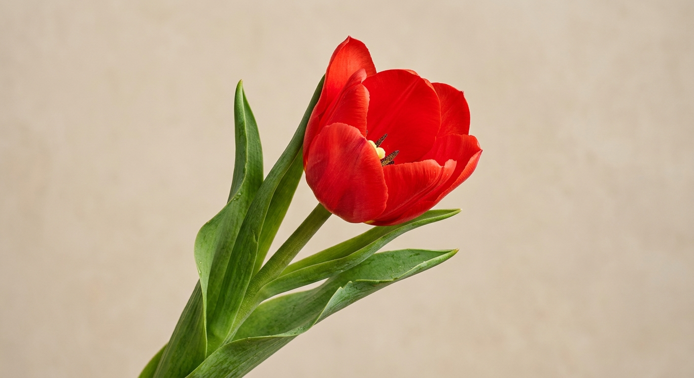
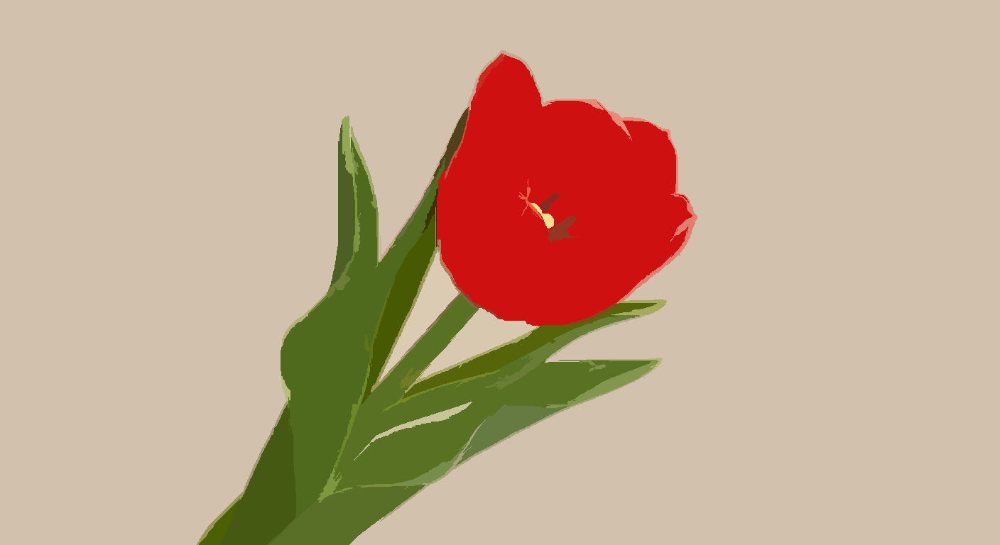
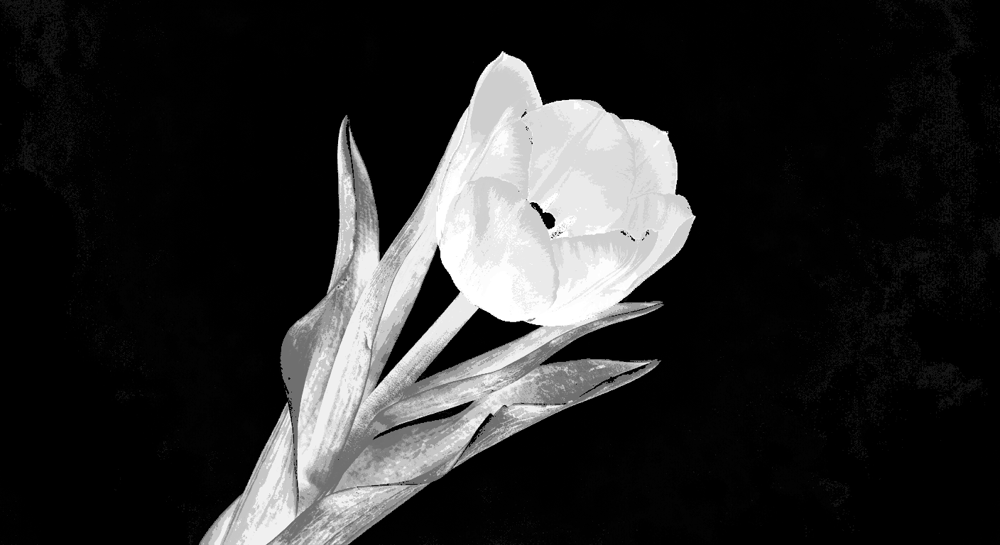
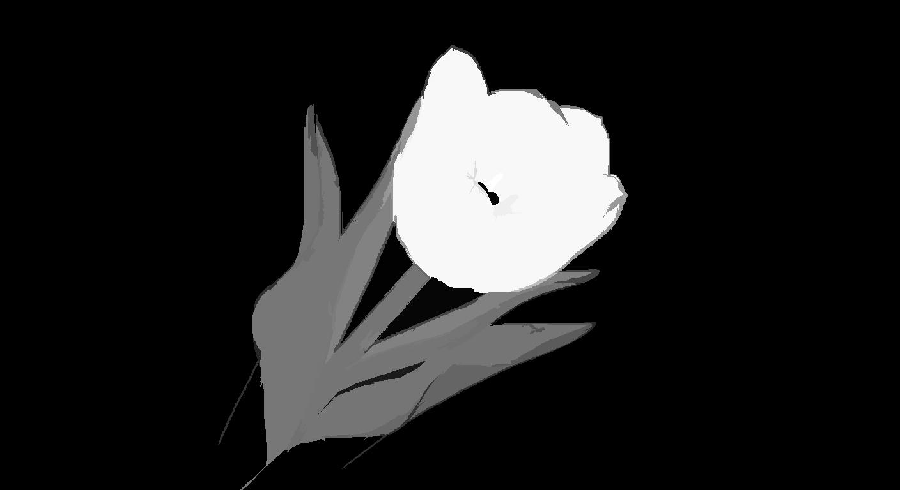
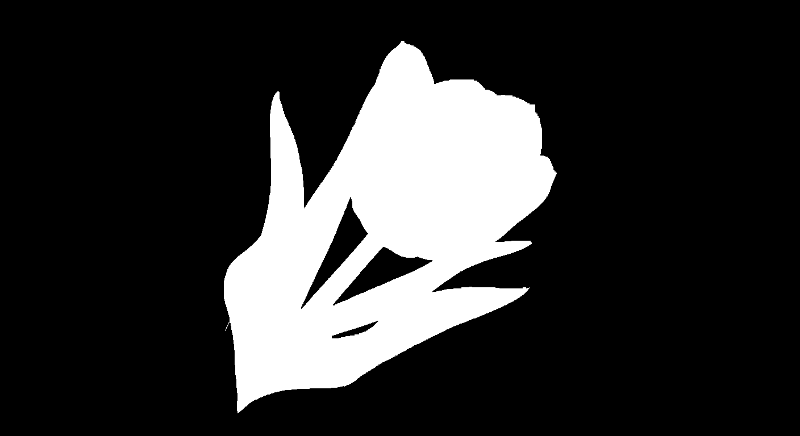
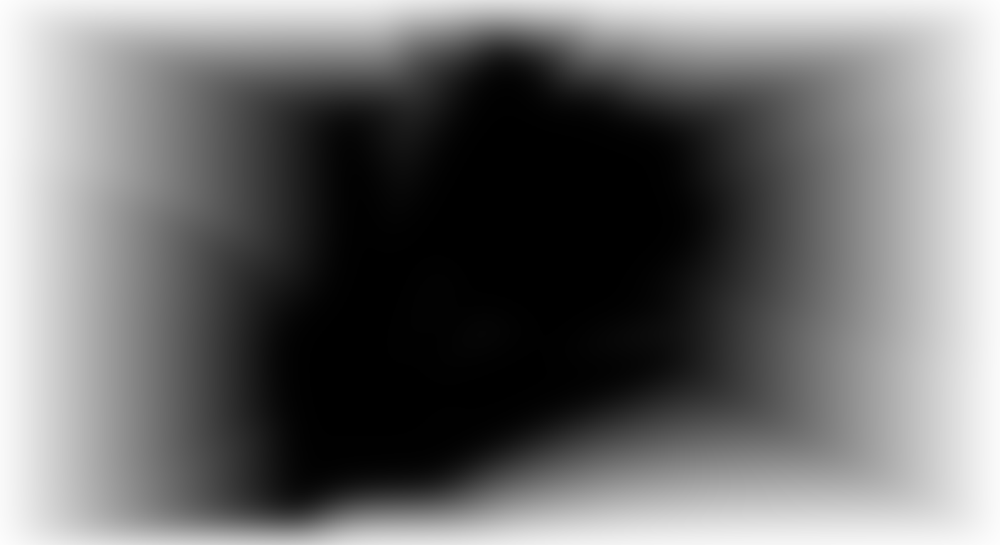
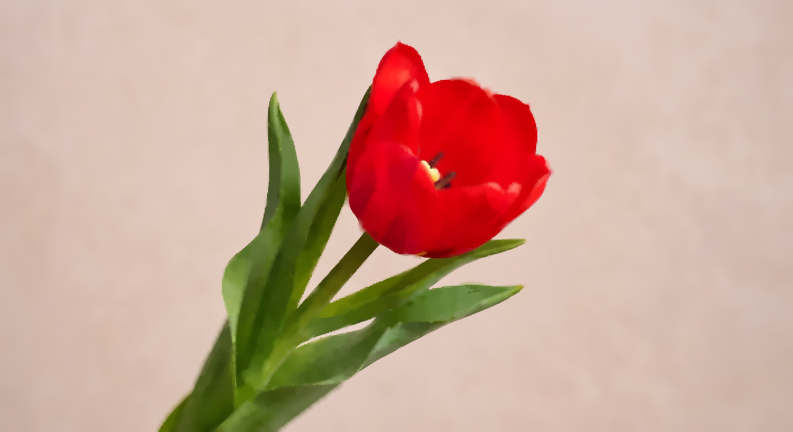
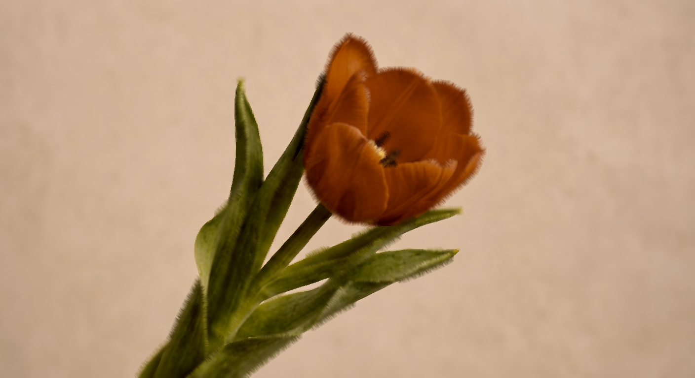

# Leiter

[](https://github.com/mrazza/Leiter/actions/workflows/test.yml)
[](https://dotnet.microsoft.com/)
[](LICENSE.md)

A pure-C# image processing, computer vision, and non-photorealistic rendering (NPR) library targeting **.NET 10**. `Leiter` provides strongly-typed generic pixel and matrix abstractions with **zero external dependencies** in its core library, cross-platform (`SixLabors.ImageSharp`) and Windows GDI+ (`System.Drawing.Common`) image adapters, and a complete end-to-end artistic **photo watercolorization** pipeline composed from modular primitives.

---

## Features

- **Generic Core & Region Graphs:** Strongly-typed pixel (`Rgb8`, `Rgb64`, `Lab32`, `Xyz32`, `DoublePixel`, `LongPixel`), matrix, and boolean mask types paired with disjoint-set and region-adjacency graph primitives.
- **Color Science & Palette Transfer:** Bidirectional conversions across **sRGB**, **Linear RGB**, **CIEXYZ**, and **CIELAB** (D65 & Illuminant E with Bradford adaptation), CIE76 & CIEDE2000 color difference, per-channel LUTs, quantization, and Reinhard statistical color transfer.
- **Image Segmentation:** Multi-threaded Felzenszwalb–Huttenlocher (**EGBI**), Comaniciu–Meer **Mean-Shift**, and **GrabCut** foreground extraction.
- **Visual Saliency & Distance Transforms:** Global and Regional Contrast saliency, iterative `SaliencyCut` masking, binary morphology, and Jump Flooding (**JFA**) distance fields.
- **Filtering, Gradients, Noise & Anti-Aliasing:** Separable and recursive Gaussian blurs, box and oriented elliptical filters, `Sobel`/`Scharr` gradients, bilinear/box/nearest resampling and displacement warping, fractal Perlin noise, and **FXAA 3.11**.
- **Stylization & Photo Watercolorization:** Saliency-guided LOD abstraction, pigment blending, tone curves, wet-in-wet bleeding, hand-tremor warping, paper granulation, resolution/content-aware option tuning (`ForSize`/`ForImage`), and an end-to-end `WatercolorPipeline`.
- **Multi-OS Platform Support:** Adapters for cross-platform `SixLabors.ImageSharp` and Windows GDI+ (`System.Drawing.Common`).

---

## Example Usage

### 1. Segmentation, Visual Saliency & Salient Object Extraction

Loads an image, computes EGBI segmentation in CIELAB, evaluates Global and Regional Contrast Saliency, and extracts a refined foreground mask plus normalized saliency distance field via `SaliencyCut` and `1+JFA`:

```csharp
using SixLabors.ImageSharp;
using SixLabors.ImageSharp.PixelFormats;
using Leiter.Core;
using Leiter.Pixels;
using Leiter.Pixels.ColorSpaces;
using Leiter.Algorithms;
using Leiter.Algorithms.DataStructures;
using Leiter.Algorithms.Saliency;
using Leiter.Algorithms.Segmentation;
using Leiter.Platform.ImageSharp; // Or Leiter.Platform.Windows on Windows

class Program
{
    static void Main()
    {
        // 1. Load an image and convert to a generic Leiter Matrix
        using Image<Rgb24> image = Image.Load<Rgb24>("examples/input.png");
        Matrix<Rgb8> imageMatrix = image.ToSequentialMatrix();

        // 2. Smooth with Gaussian blur and convert to CIELAB for perceptual segmentation
        Matrix<Rgb8> blurred = Blur.GaussianBlur(imageMatrix, sigma: 0.8);
        Matrix<Lab32> labImage = blurred.Map(static pixel => pixel.ToLab32(RgbColorSpace.SRgb));

        // 3. Segment with EGBI (Felzenszwalb–Huttenlocher)
        var egbiOptions = new EgbiOptions(KFactor: 50.0, Epsilon: 1.0, MinRegionSize: 200);
        IDisjointSet segmentation = EgbiSegmentation.Segment(labImage, egbiOptions);

        Matrix<Rgb8> segmented = SegmentationVisualizer.ColorRegions(
            imageMatrix,
            segmentation.ToRegions(),
            SegmentationVisualizer.AverageColorAssigner());
        using Image<Rgb24> segmentedImg = segmented.ToImage();
        segmentedImg.Save("segmented.png");

        // 4. Compute Global (HC) and Regional (RC) Contrast Saliency
        Matrix<DoublePixel> globalSaliency = GlobalContrastSaliency.ComputeSaliency(imageMatrix);
        Matrix<DoublePixel> regionalSaliency = RegionalContrastSaliency.ComputeSaliency(imageMatrix, segmentation);

        // 5. Extract a refined binary foreground mask and smoothed [0, 1] distance field
        (MaskMatrix salientMask, Matrix<DoublePixel> distanceField) = SaliencyDistanceField.Compute(
            imageMatrix,
            regionalSaliency,
            new SaliencyCutOptions(MaxOuterIterations: 4));
    }
}
```

### 2. Artistic Photo Watercolorization

Runs the complete 6-stage photo watercolorization pipeline in a single call, or with per-stage customization and intermediate artifact inspection:

```csharp
using SixLabors.ImageSharp;
using SixLabors.ImageSharp.PixelFormats;
using Leiter.Algorithms.Segmentation;
using Leiter.Algorithms.Stylization.Watercolor;
using Leiter.Core;
using Leiter.Pixels;
using Leiter.Platform.ImageSharp;

using Image<Rgb24> input = Image.Load<Rgb24>("examples/input.png");
Matrix<Rgb8> source = input.ToSequentialMatrix();

// Option A: Render with default parameters and automatic palette matching
Matrix<Rgb8> watercolor = WatercolorPipeline.Render(source);
using Image<Rgb24> watercolorImg = watercolor.ToImage();
watercolorImg.Save("watercolor.png");

// Option B: Automatically scale and tune all stage options to the input image
// (individual stages also expose *Options.ForImage(...) and *Options.ForSize(...))
WatercolorOptions autoOptions = WatercolorOptions.ForImage(source);
Matrix<Rgb8> resolutionTuned = WatercolorPipeline.Render(source, autoOptions);

// Option C: Tune stage options explicitly and inspect intermediate pipeline artifacts
var options = new WatercolorOptions(
    TargetPalette: WatercolorPalettes.WarmOchreEarth,
    MeanShift: new MeanShiftOptions(SpatialRadius: 8, RangeRadius: 5.5, MinRegionSize: 50),
    WetInWet: new WetInWetOptions(Mode: WetInWetMode.Default),
    HandTremor: new HandTremorOptions(Amplitude: 2.5),
    PaperGranulation: new PaperGranulationOptions(DensityStrength: 0.3, WarpAmplitude: 0.6));

WatercolorResult detailed = WatercolorPipeline.RenderDetailed(source, options);
// Available artifacts: detailed.ColorTransferred, detailed.SelectedPalette,
// detailed.SaliencyMap, detailed.SalientMask, detailed.SaliencyDistanceField,
// detailed.SegmentationGraph, detailed.LodAbstracted, detailed.WetInWet (.Image, .WetAreaMask),
// detailed.HandTremor, and detailed.Image.
```

---

## Visual Showcases

### Segmentation, Visual Saliency & Salient Object Extraction

| Original Input | EGBI Segmentation | Global Contrast Saliency (HC) |
|:---:|:---:|:---:|
|  |  |  |
| *Input image (`1408×768`)* | *EGBI regions (`k = 50, min = 200`)* | *Histogram-based global contrast* |

| Regional Contrast Saliency (RC) | `SaliencyCut` Foreground Mask | Saliency Distance Field (`1+JFA`) |
|:---:|:---:|:---:|
|  |  |  |
| *Segmentation-weighted regional contrast* | *Iterative `GrabCut` + morphology refinement* | *Collinear ray–border normalized & smoothed* |

### Photo Watercolorization Pipeline

| Stage 3: LOD Abstraction | Stage 4: Wet-in-Wet Bleeding | Stage 5: Hand Tremor Effect | Stage 6: Final Watercolor Painting |
|:---:|:---:|:---:|:---:|
|  |  |  |  |
| *Saliency-guided Mean-Shift abstraction* | *Oriented elliptical feathering* | *Perlin edge warp, gaps & glazes* | *Edge darkening, granulation & FXAA* |

---

## Solution Architecture & CLI Harness

- **`Leiter`**: Zero-dependency core library containing matrices, pixel types, color spaces, vision algorithms, and stylization pipelines.
- **`Leiter.Platform.ImageSharp`**: Cross-platform image I/O via `SixLabors.ImageSharp`.
- **`Leiter.Platform.Windows`**: Native Windows GDI+ (`System.Drawing.Common`) image I/O via `Bitmap.LockBits`.
- **`Leiter.Tests`**: Unit test suite validating core math, platform interop, and algorithm behavior.
- **`LeiterTest`**: CLI benchmark harness executing the library's operations against an input image.

### Build, Test & Run CLI Benchmark

```bash
# Build the full solution in Release mode
dotnet build Leiter.slnx --configuration Release

# Run the xUnit test suite
dotnet test Leiter.slnx --configuration Release

# Run the CLI harness against an image (writes benchmark timings & PNG outputs)
dotnet run --project LeiterTest --configuration Release -- examples/input.png ./output
```

---

## References

- Wang, M., Wang, B., Fei, Y., Qian, K., Wang, W., Chen, J., & Yong, J.-H. *"Towards Photo Watercolorization with Artistic Verisimilitude."* IEEE TVCG, 2014.
- Cheng, M.-M., Mitra, N. J., Huang, X., Torr, P. H. S., & Hu, S.-M. *"Global Contrast Based Salient Region Detection."* IEEE TPAMI, 2015.
- Felzenszwalb, P. F., & Huttenlocher, D. P. *"Efficient Graph-Based Image Segmentation."* IJCV, 2004.
- Comaniciu, D., & Meer, P. *"Mean Shift: A Robust Approach Toward Feature Space Analysis."* IEEE TPAMI, 2002.
- Rother, C., Kolmogorov, V., & Blake, A. *"'GrabCut' — Interactive Foreground Extraction using Iterated Graph Cuts."* ACM TOG (SIGGRAPH), 2004.
- Bousseau, A., Kaplan, M., Thollot, J., & Sillion, F. X. *"Interactive Watercolor Rendering with Temporal Coherence and Abstraction."* NPAR, 2006.
- Reinhard, E., Adhikhmin, M., Gooch, B., & Shirley, P. *"Color Transfer between Images."* IEEE CG&A, 2001.
- Rong, G., & Tan, T.-S. *"Jump Flooding in GPU with Applications to Voronoi Diagram and Distance Transform."* ACM I3D, 2006.
- Young, I. T., & van Vliet, L. J. *"Recursive Implementation of the Gaussian Filter."* Signal Processing, 1995; Triggs, B., & Sdika, M. *"Boundary Conditions for Young–van Vliet Recursive Filtering."* IEEE TSP, 2006.
- Lottes, T. *"FXAA 3.11."* NVIDIA, 2011.

---

## License

This project is licensed under the GNU Lesser General Public License v3.0 (LGPL-3.0) — see [LICENSE.md](LICENSE.md) for details.
